# Microsoft Azure Administrator (AZ-104) — Hands-On Enterprise Lab Portfolio

Complete end-to-end Azure infrastructure implementation covering all 5 official **AZ-104** exam domains, built with production governance guardrails, zero-trust network segmentation, automated scaling, and disaster recovery controls.

---

## Domain 1: Manage Azure Identities and Governance (20–25%)

### 1.1 Azure Policy & Resource Locks
Enforced mandatory `Environment` tag governance at the Resource Group scope and applied `CanNotDelete` locks on critical infrastructure.
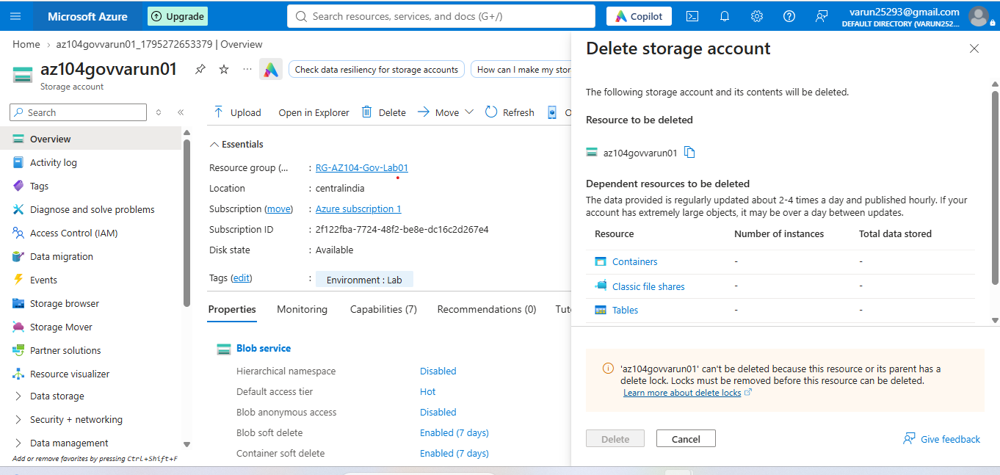

### 1.2 Custom RBAC Role Definition
Authored and deployed a least-privilege JSON custom RBAC role scoped to subscription resources.
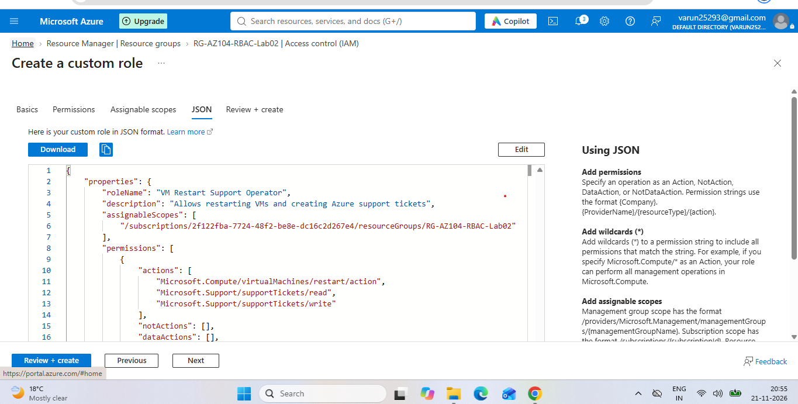

### 1.3 Management Groups Hierarchy
Structured enterprise management group hierarchy (`Production` / `Development`) for inherited policy and billing governance.
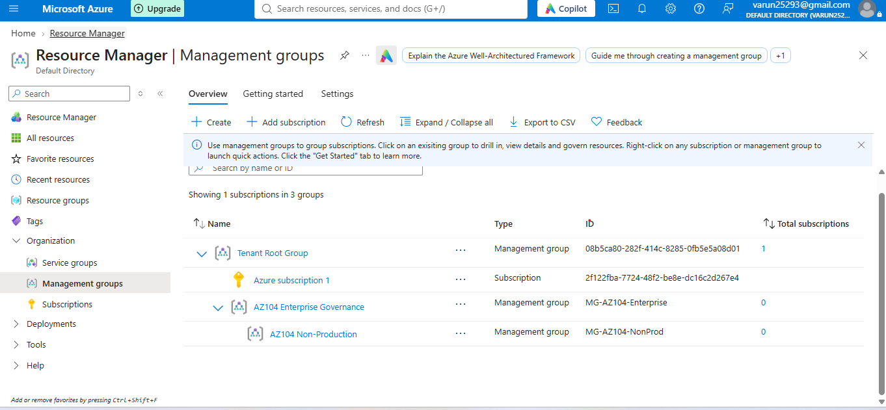

### 1.4 Cost Management & Budget Alerts
Configured proactive forecasted and actual spend threshold alerts (`50%`, `80%`, `100%`) to enforce strict FinOps discipline.
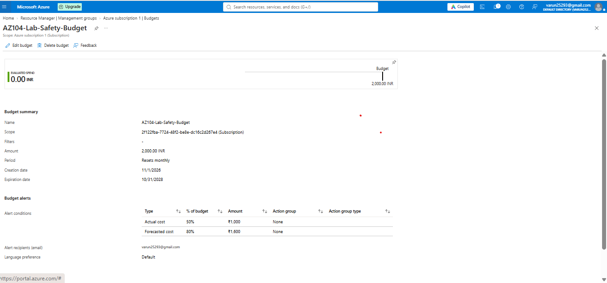

---

## Domain 2: Implement and Manage Storage (15–20%)

### 2.1 Shared Access Signatures & Stored Access Policies
Implemented revocable container-level Stored Access Policies paired with time-bound, HTTPS-only SAS tokens.
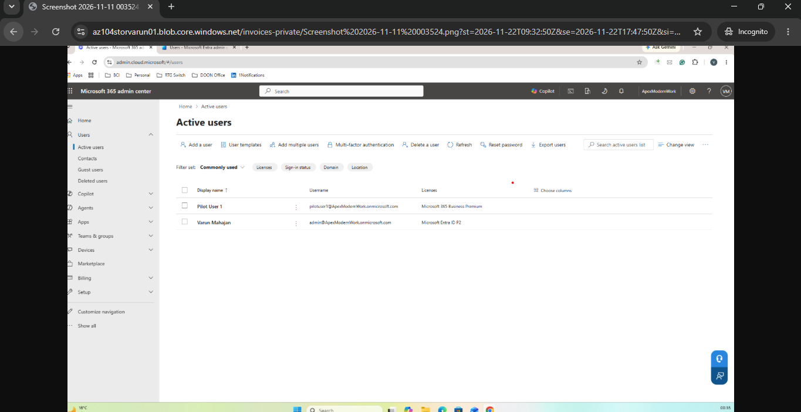

### 2.2 Blob Lifecycle Management
Automated data tiering (`Hot` → `Cool` → `Archive` / `Delete`) based on last-modified age thresholds to optimize storage costs.
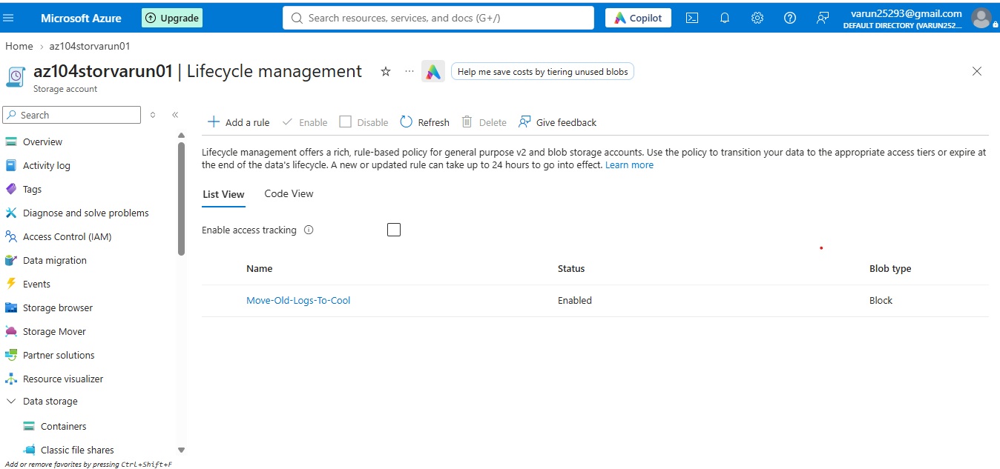

### 2.3 Azure Files SMB Integration
Provisioned an enterprise SMB file share and mounted it over port `445` (`Test-NetConnection` verified) as a persistent network drive.
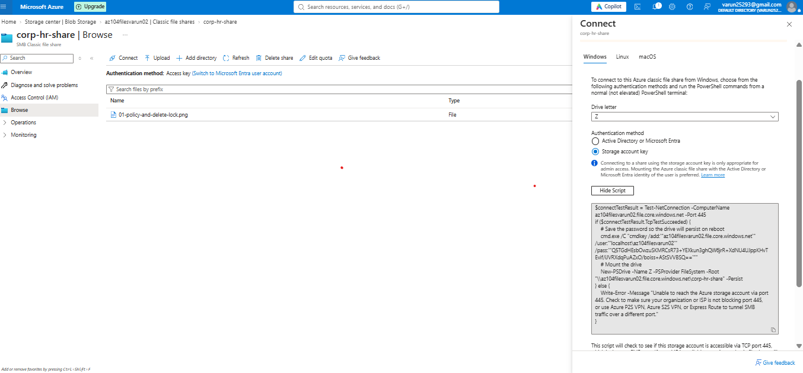

### 2.4 Blob Soft Delete & Point-in-Time Recovery
Validated accidental deletion recovery by restoring soft-deleted blobs within the retention window.
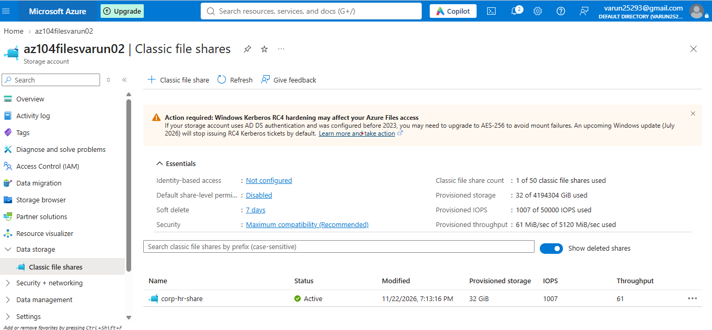

---

## Domain 3: Deploy and Manage Azure Compute Resources (20–25%)

### 3.1 Zone-Pinned Virtual Machine Deployment
Deployed an Availability Zone-pinned VM (`Central India`, Zone 1) with static private networking and hardened NSG rules.
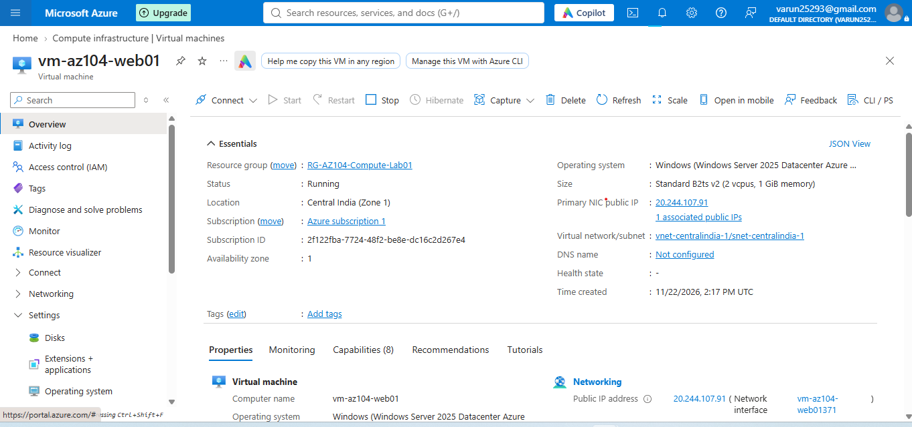

### 3.2 Custom Script Extension Automation
Automated post-deployment web server provisioning (`IIS`) and custom HTML payload injection without manual RDP intervention.
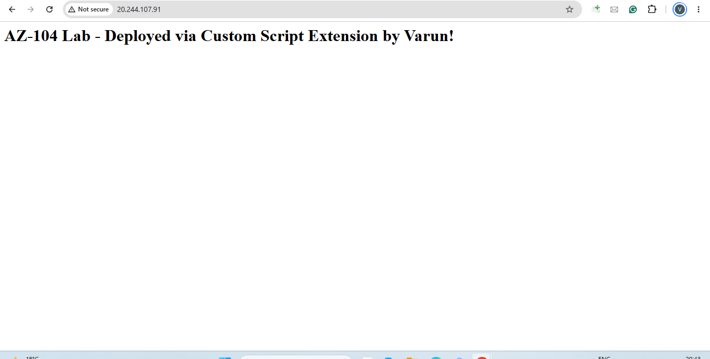

### 3.3 VM Scale Sets (VMSS) & Custom Autoscale
Deployed a Flexible orchestration VMSS configured with metric-driven CPU scale-out (`> 80%`) and scale-in (`< 20%`) rules across `1–3` instances.
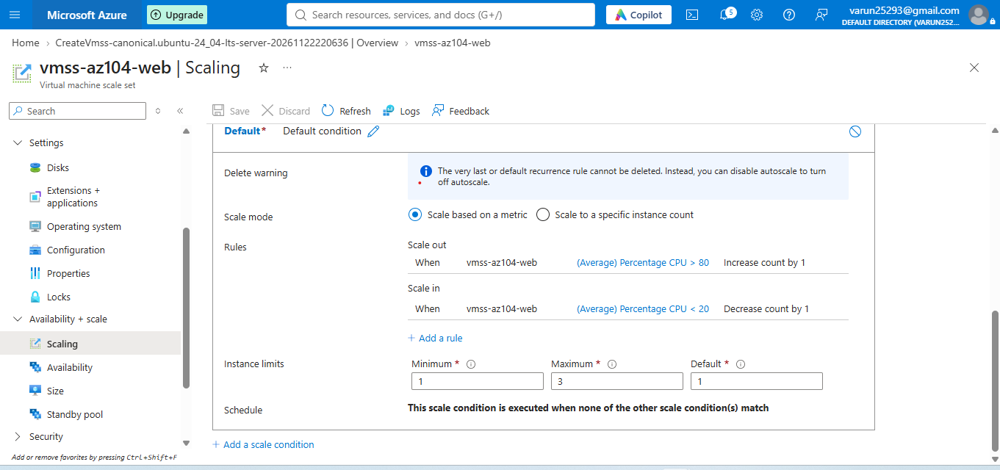
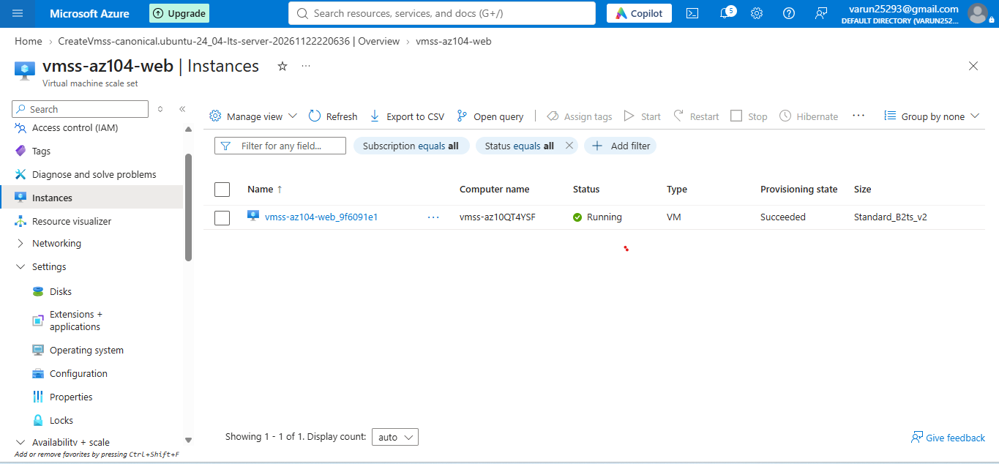

### 3.4 App Service & Zero-Downtime Deployment Slots
Configured a `staging` deployment slot on a Standard App Service Plan and executed zero-downtime VIP swaps with `production`.
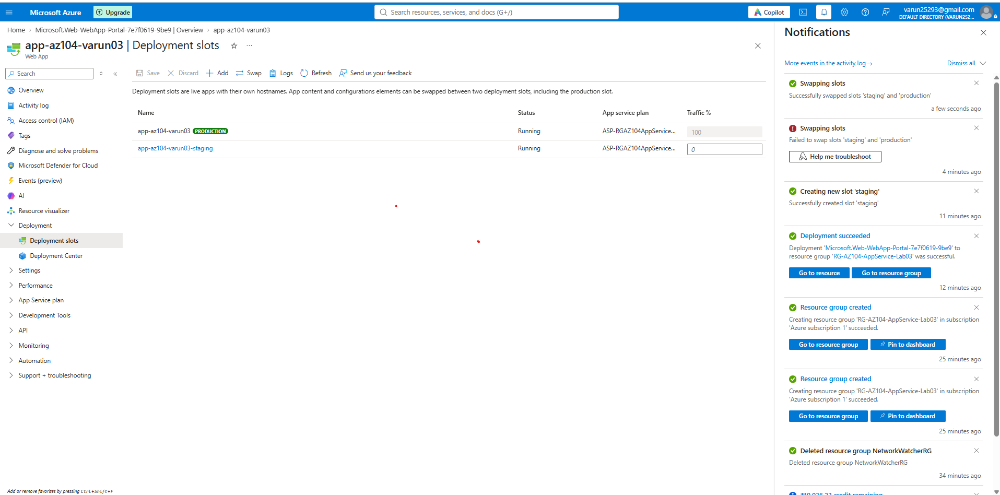

---

## Domain 4: Implement and Manage Virtual Networking (15–20%)

### 4.1 Hub-and-Spoke VNet Peering
Connected non-overlapping Hub (`10.10.0.0/16`) and Spoke (`10.20.0.0/16`) virtual networks with bidirectional `Fully Synchronized` peering over Azure's private backbone.
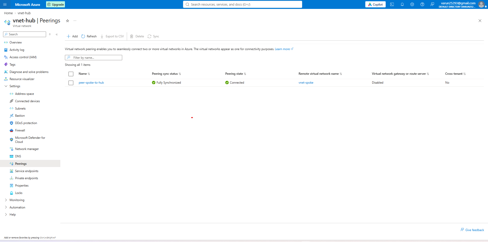

### 4.2 Network Security Group (NSG) Micro-Segmentation
Restricted Spoke subnet ingress to HTTPS (`TCP/443`) exclusively from the Hub management CIDR (`10.10.1.0/24`) at Priority `100`.
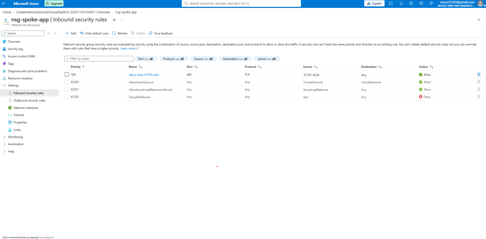

---

## Domain 5: Monitor and Maintain Azure Resources (10–15%)

### 5.1 Azure Monitor Metric Alerts & Action Groups
Built a real-time `Percentage CPU > 80%` metric alert rule integrated with an email-enabled Action Group (`ag-az104-admin`).
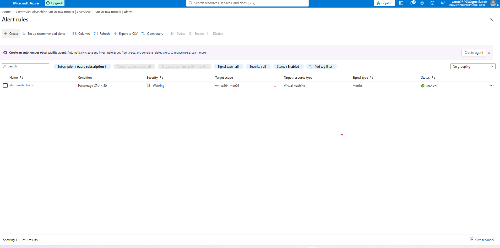

### 5.2 Recovery Services Vault & VM Backup
Configured automated daily VM protection (`EnhancedPolicy`) in a Recovery Services Vault (`rsv-az104-centralindia`) with soft-delete retention.
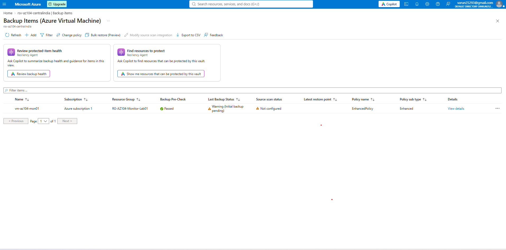
